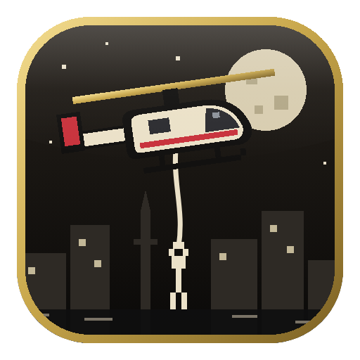

<p align="center"></p>

<h1 align="center">IBRA RESCUE — حبل النجاة 🚁</h1>

<p align="center">لعبة إنقاذ بالهليكوبتر والحبل — بكسل آرت، مهمات بمدن العالم، تعليقات مضحكة بالعراقي والإنكليزي</p>

---

## 🎮 فكرة اللعبة
تطير بهليكوبتر يتدلى منها **حبل حقيقي (فيزياء)**. تنزّل الحبل على الناس العالقين فوق السطوح أو بالماي، فيمسكون الحبل ويتعلقون واحد تحت الثاني، وبعدها توصّلهم للقارب أو المهبط.
- إذا هزّيت الحبل هواية أو ضربت بالحيطان → يطيحون! (بس بخير 😄 يسبحون أو يگعدون دايخين وترجع تاخذهم)
- إذا ضربت الطيارة ببناية → *"اليوم الأول بالشغل… آسف"*
- كل شخص يحچي: "لا تفلتني!"، "ثقيل هواية جوه!"، "منو حط هالبناية هنا؟!"، "شكراً عمي!"…
- راديو البرج يعلّق على كل شي: *"البرج: اليوم بلا حوادث رجاءً"*

## 🗺️ المهمات (10)
| # | المدينة | المهمة | الطقس |
|---|---|---|---|
| 1 | بغداد | اليوم الأول | صافي (نهار) |
| 2 | بغداد | دجلة فاض | فيضان يرتفع |
| 3 | الأهوار | المضيف | رياح |
| 4 | طوكيو | ليلة هادئة | صافي |
| 5 | طوكيو | العاصفة | مطر + برق + فيضان |
| 6 | روتردام | الميناء | مطر — **شينوك** |
| 7 | دبي | العاصفة الترابية | عاصفة ترابية |
| 8 | القاهرة | النيل | فيضان (نهار) |
| 9 | الجبال | الإعصار | إعصار يتحرك |
| 10 | مومباي | موسم الأمطار | فيضان سريع — **شينوك** |

كل مهمة تنفتح بعد اللي قبلها، وتاخذ ⭐ لحد 3 نجوم (نجحت / محد طاح / خلّصت بسرعة).

## ⌨️ التحكم
| | |
|---|---|
| الأسهم أو WASD | الطيران |
| P أو Esc | إيقاف |
| R | إعادة المهمة |
| F11 | ملء الشاشة |
| لمس | اسحب بالشاشة (عصا تحكم) |
| يد تحكم (Gamepad) | مدعومة |

## ➕ إضافة مهمة جديدة (قابلة للتطوير)
كل المهمات بملف واحد: **`app/js/missions.js`**. انسخ أي مهمة وغيّر القيم:
```js
{
  id: 'basra1', style: 'marsh', pal: 'dusk', heli: 'small',
  goal: 7, people: 9, time: 220, worldW: 1700,
  lat: 30.5, lon: 47.8,
  city: { ar: 'البصرة', en: 'Basra' }, name: { ar: 'شط العرب', en: 'Shatt al-Arab' },
  desc: { ar: 'وصف المهمة…', en: 'Mission description…' },
  weather: 'wind', zones: 'boat',
  water: { y: 260, to: 240, rate: 0.1 }, wind: { base: 8, gust: 20 },
  lines: { wait: { ar: ['تعليق خاص بهاي المهمة'], en: ['Special line'] } }
}
```
- **style**: `baghdad` · `tokyo` · `marsh` · `rotterdam` · `dubai` · `cairo` · `mountain` · `mumbai`
- **pal**: `night` · `day` · `dusk`
- **weather**: `clear` · `rain` · `storm` · `wind` · `sand` · `tornado` · `flood`
- **zones**: `pad` (مهبط) · `boat` (قوارب — تحتاج `water`)
- التعليقات العامة بملف `app/js/text.js` (قسم `LINES` و `RADIO`) — ضيف عليها براحتك.

المدينة الجديدة (شكل جديد) تنضاف بدالة الرسم بـ `app/js/levels.js`.

## 🛠️ التشغيل والبناء
```bash
npm install
npm start          # تشغيل اللعبة
npm run dist       # بناء المثبّت + النسخة المحمولة (على ويندوز)
node test/autoplay.js 0   # طيار آلي يجرّب المهمة الأولى
```
أو افتح `app/index.html` بالمتصفح مباشرة.

**النشر التلقائي:** كل دفع على `main` يبني المثبّت وينشره بـ Releases حسب رقم `version` بـ `package.json`. للتحديث: غيّر الرقم (مثلاً 1.1.0) وادفع.

---
<p align="center">برمجة وتطوير <b>إبراهيم الخزرجي</b> · <a href="https://t.me/ibraprogram">Telegram: t.me/ibraprogram</a> · <a href="https://www.tiktok.com/@ibraprogram">TikTok: @ibraprogram</a></p>
